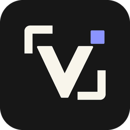
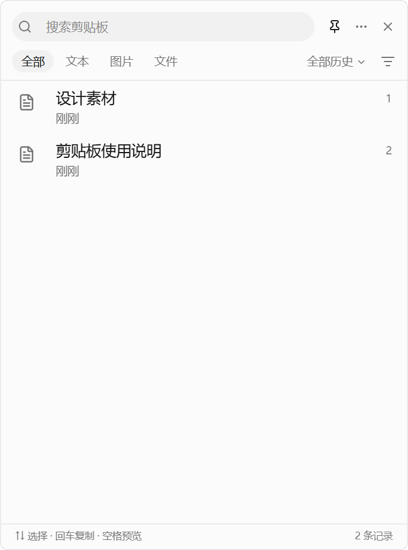
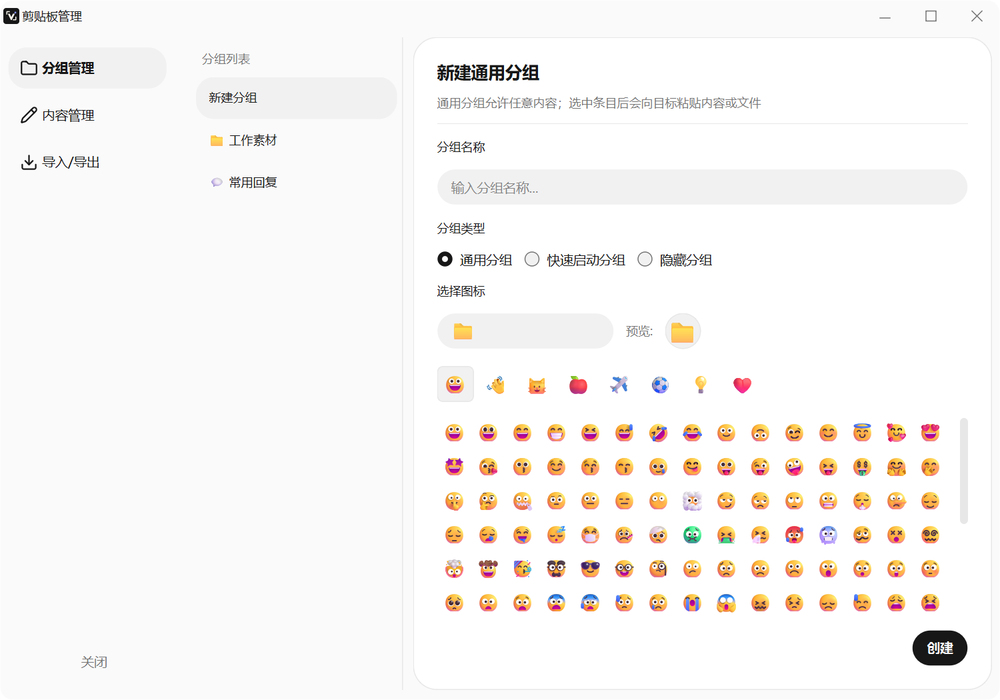
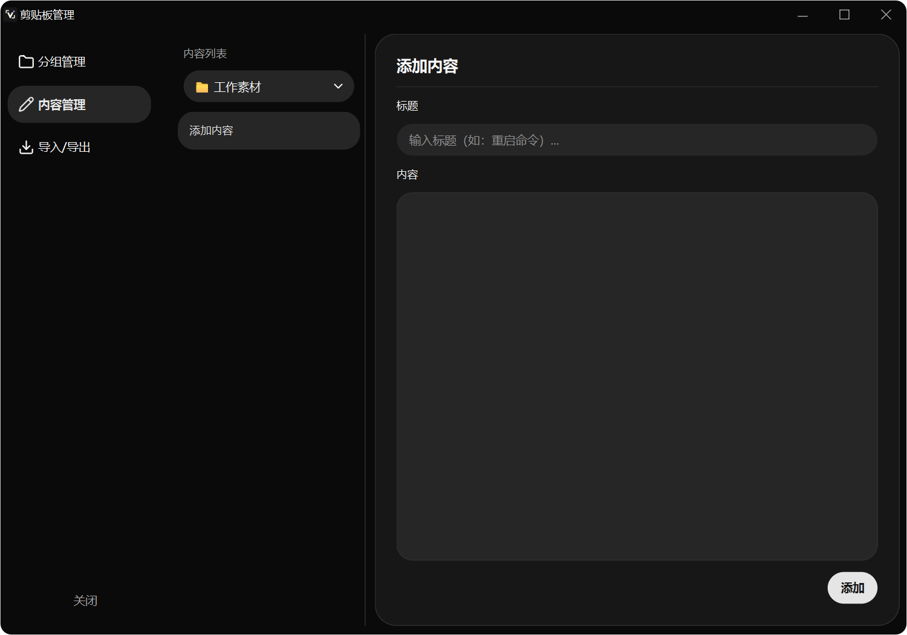

<p align="center"></p>

# VersePic

[English](README.md) · [简体中文](README_zh-CN.md) · [日本語](README_JA.md)

A focused Windows workspace for screenshots, clipboard history and visual references. Capture a detail, annotate it, keep it on screen, and retrieve it later without breaking your flow.

## What you can do

- **Capture and annotate:** region/window capture, scrolling screenshots, shapes, arrows, text and mosaic.
- **Keep references visible:** pin images above other windows, zoom and annotate them.
- **Find copied content:** search text, images and files; use groups, tags, type/date filters and reusable snippets.
- **Manage your library:** create groups, edit saved content, and import/export text content as CSV.
- **Read and share:** local PP-OCR recognition, configured translation services, GIF recording, barcode scanning and PDF export.
- **A quieter interface:** neutral light/dark surfaces, rounded controls, official Lucide icons and short interaction transitions.

## App screenshots

Screenshots below show real application windows with isolated demonstration data, not personal clipboard contents.

| Clipboard | Manage |
| --- | --- |
|  |  |



## Download and run

1. Open [Releases](https://github.com/Baixu22/versepic/releases).
2. Download the Windows x64 ZIP and extract the entire archive.
3. Run **versepic.exe**. Keep **models/** beside the executable; both OCR models are included.
4. Open the system tray icon to capture, open clipboard history, or change settings and shortcuts.

No Python installation is needed for the packaged build. The executable is unsigned. This release is x64; ARM64 is a source/build target, not a tested binary supplied by this release. In-app update checks read the public Releases API, so they work without a GitHub account.

## Data and compatibility

Clipboard history and OCR processing stay on the device. Translation uses the provider you configure and sends the selected text to that provider. Existing Jietuba settings/data identifiers are retained for compatibility; branding changes do not create an empty replacement library. CSV export covers saved text, not a complete image/database backup.

## Build from source

The project targets Windows and Python 3.11; the local release was built with Python 3.12. Install matching native wheels for your architecture.

```powershell
py -3.11 -m venv .venv
.venv/Scripts/python -m pip install -r requirements.txt
.venv/Scripts/python -m pip install -r requirements-dev.txt
.venv/Scripts/python main/main_app.py
```

Native modules `pyclipboard`, `longstitch`, `gifrecorder` and `ppocr_rust` are supplied by the packages in requirements.txt; their Rust sources are under rust_libs/. Keep the bundled models/ directory. For source-built native wheels, follow the build steps in [.github/workflows/build.yml](.github/workflows/build.yml).

```powershell
.venv/Scripts/python -m pytest main/tests -q
.venv/Scripts/python build_with_ocr_onefile.py
```

Build output: **dist/versepic.exe** and **dist/models/**. Package them together. Local UI reviews and build outputs are excluded from Git.

## Credits and license

VersePic builds on [Jietuba](https://github.com/1003129155/jietuba). Original copyright and the [MIT license](LICENSE) are retained. UI icons are [Lucide](https://lucide.dev), with its [license](svg/lucide/LICENSE) included. The VersePic app mark was generated using the configured image API and adapted into PNG/ICO assets.

---

## Directory Structure

<details>
<summary>Expand directory structure</summary>

```text
# Project root
├── README.md / README_zh-CN.md / README_JA.md          # English, Chinese, and Japanese documentation
├── pyproject.toml                                      # Python project metadata and dependency declarations
├── requirements.txt                                   # Runtime dependencies
├── requirements-dev.txt                               # Test and build dependencies
├── build_with_ocr_onefile.py                           # PyInstaller one-file build script
│
├── main/                    # Python main program
│   ├── main_app.py          # App entry point: system tray, global hotkeys, lifecycle management
│   ├── compile_translations.py  # Translation compiler (.xml → .qm)
│   ├── scripts/             # Helper scripts — translation provider comparison
│   │
│   ├── barcode/             # Barcode module — QR code/barcode scanning (zxing-cpp)
│   ├── canvas/              # Canvas module — graphics editing core
│   ├── capture/             # Capture module — screen capture & window detection
│   ├── clipboard/           # Clipboard module — history, groups/quick launch, import/export, search
│   ├── core/                # Core module — bootstrap, logging, resources, theme, i18n, hotkeys
│   ├── gif/                 # GIF module — screen recording, editing, playback, export
│   ├── ocr/                 # OCR module — PP-OCR text recognition
│   ├── pin/                 # Pin module — pinned screenshots, editing, OCR, translation
│   ├── settings/            # Settings module — unified configuration management
│   ├── stitch/              # Stitch module — scroll capture, auto-stitching
│   ├── tools/               # Tools module — pen, rect, arrow, text, mosaic, etc.
│   ├── translation/         # Translation module — multi-provider translation service
│   ├── translations/        # Language resources — Chinese/English/Japanese/Korean
│   ├── ui/                  # UI module — common UI component library
│   └── tests/               # Tests module — unit tests & integration tests
│
├── rust_libs/               # Rust library source code (buildable from source)
│   ├── gifrecorder/         # GIF/video composition encoder source
│   ├── longstitch/          # Long screenshot stitching algorithm source
│   ├── pyclipboard/         # Low-level clipboard operations source
│   └── ppocr_rust/          # PP-OCR (PaddleOCR) ONNX recognition engine source
│
├── models/                  # PP-OCR ONNX models (required for OCR)
│   ├── PP-OCRv6_det_small.onnx   # text detection model (DBNet)
│   └── PP-OCRv6_rec_small.onnx   # text recognition model (CRNN/CTC)
│
└── svg/                     # SVG icon assets
```

</details>

---

## Module Details

### barcode/ — Barcode Module

Scans QR codes and barcodes in the screenshot selection. The result window outlines each code on the screenshot and lists the decoded contents by number.

<details>
<summary>Expand directory structure</summary>

```text
barcode/
├── __init__.py
├── reader.py                # read_codes / DecodedCode — zxing-cpp decoding; text, format and outline in reading order
└── result_window.py         # BarcodeResultWindow — result window; screenshot and result list share the same numbers
```

</details>

- Supports QR Code, Data Matrix, Aztec, PDF417 and common linear barcodes such as Code 128 and EAN/UPC
- Reads every code in the selection at once; hovering a code on either side highlights it on both
- One-click copy; http(s) links open directly in the browser

---

### canvas/ — Canvas Module

Graphics editing canvas system with scene management, view rendering, item selection, and undo/redo.

<details>
<summary>Expand directory structure</summary>

```text
canvas/
├── __init__.py
├── scene.py                 # CanvasScene — canvas scene, extends QGraphicsScene
├── view.py                  # CanvasView — canvas view, extends QGraphicsView
├── selection_model.py       # SelectionModel — manages selected graphics items
├── undo.py                  # CommandUndoStack — undo/redo stack (add, delete, batch, edit commands)
├── smart_edit_controller.py # SmartEditController — handles selection/edit mode switching
├── smart_selection_anim.py  # SmartSelectionAnimator — tweens the selection when it hops between windows
├── handle_editor.py         # LayerEditor / EditHandle — control point drag editing
├── gestures.py              # Mouse gesture state machines — text edge drag, rubber-band select, pending click-to-edit
├── handle_overlay.py        # HandleOverlay — separate compositing layer for edit handles, avoids full-scene repaint
└── items/
    ├── drawing_items.py     # StrokeItem / RectItem / EllipseItem / NumberItem — items sharing DrawingItemMixin
    ├── background_item.py   # BackgroundItem — selection area background
    ├── mosaic_item.py       # MosaicItem — pixel mosaic item
    ├── spotlight_item.py    # SpotlightItem / SpotlightCurtain — spotlight holes and their shared curtain
    ├── magnify_item.py      # MagnifyCalloutItem — exportable magnified region of original pixels
    ├── callout_link.py      # callout_link — link and geometry sync for arrow + text-bubble callouts
    ├── image_stamp_item.py  # ImageStampItem — inserted bitmap (proportional resize, undoable, stored in the project)
    ├── selection_item.py    # SelectionItem — selection boundary display
    ├── arrow_item.py        # ArrowItem — arrow item, geometry for nine shaft and head styles
    └── text_item.py         # TextItem — text item, outline/shadow/background and tri-state interaction frame
```

</details>

---

### capture/ — Capture Module

Screen capture and smart window detection.

<details>
<summary>Expand directory structure</summary>

```text
capture/
├── capture_service.py       # CaptureService — core screenshot logic
├── quick_capture.py         # Validated quick-capture requests for screen, window and last region
├── region_presets.py        # Named screen regions with layout and DPI validation
├── cursor_capture.py        # Native Windows pointer snapshots and hotspot-aware compositing
├── multi_region.py          # Ordered crops of one frozen frame with undo/redo
├── uia_element_finder.py    # Background UI Automation element snapshots for smart selection
└── window_finder.py         # WindowFinder — smart window selection, cursor-based detection
```

</details>

---

### clipboard/ — Clipboard Management Module

Ditto-like clipboard history manager, now organized into controllers, core, services, and ui layers.
Supports text, images, HTML, files, a dedicated three-pane management window, and pin creation from history items.

<details>
<summary>Expand directory structure</summary>

```text
clipboard/
├── __init__.py
├── controllers/             # Control layer — history loading, paste flow, menus, selection state
│   ├── clipboard_controller.py   # ClipboardController — loading, pasting, context menu logic
│   ├── selection_manager.py      # SelectionManager — list selection state
│   ├── context_menu_controller.py  # ContextMenuController — assembles context menu data and actions
│   ├── foreground_tracker.py    # ForegroundWindowTracker — remembers the window to paste into
│   ├── paste_keystroke.py       # Restores focus to the target window, then sends Ctrl+V
│   └── __init__.py
├── core/                    # Data layer — pyclipboard wrapper, models, group types
│   ├── manager.py           # ClipboardManager — storage, monitoring, and paste API
│   ├── models.py            # ClipboardItem / Group models
│   ├── enums.py             # GroupType definitions
│   ├── text_transform.py    # Plain-text transforms — pure functions behind "paste special"
│   ├── tag_store.py         # TagStore — tag definitions and item-tag mappings
│   ├── image_text.py        # Local image text index, search, and serial background OCR
│   └── __init__.py
├── services/                # Service layer — file payloads, group rules, import/export, save logic
│   ├── file_payload_service.py   # file payload JSON + legacy format compatibility
│   ├── group_service.py          # group icon/name/delete helpers
│   ├── import_export_service.py  # CSV import/export for text items
│   └── manage_dialog_service.py  # persistence logic for the management window
├── ui/
│   ├── layout_scale.py           # Shared size metrics for the management dialog
│   ├── dialogs/
│   │   └── manage_dialog.py      # three-pane management window for groups and content
│   ├── forms/
│   │   ├── group_form.py
│   │   ├── text_content_form.py
│   │   ├── file_content_form.py
│   │   ├── import_export_form.py
│   │   └── group_icon_picker.py
│   ├── menus/
│   │   ├── action_menu.py
│   │   ├── group_context_menu.py
│   │   └── item_context_menu.py
│   ├── mixins/
│   │   └── frameless_mixin.py
│   ├── panels/
│   │   └── setting_panel.py
│   ├── resources/
│   │   └── emoji_data.py
│   ├── theme/
│   │   ├── themes.py
│   │   └── theme_styles.py
│   ├── widgets/
│   │   ├── draggable_list_widget.py
│   │   ├── manage_list_delegate.py
│   │   ├── group_bar.py
│   │   ├── item_delegate.py
│   │   ├── item_widget.py
│   │   └── preview_popup.py
│   └── windows/
│       ├── clipboard_window.py   # history window, search, preview, quick paste
│       └── pin_window.py         # create pins from history items
```

</details>

**Core Features:**
- Monitor clipboard changes and store history automatically
- Support text, images, HTML, and files
- Support general groups, quick-launch groups, favorites, and search
- Dedicated three-pane management window for editing groups, text items, and file items
- CSV import/export for text items
- Themeable UI, quick paste shortcuts, and large image/long text preview popups

---

### core/ — Core Module

Logging, resource loading, theme management, i18n, hotkeys, and other infrastructure.

<details>
<summary>Expand directory structure</summary>

```text
core/
├── bootstrap.py             # PreloadManager — startup bootstrap, env init, DPI, single instance
├── single_instance.py       # SingleInstanceGuard — atomic named-mutex guard, one instance at a time
├── logger.py                # Logger — file + console logging (debug/info/warning/error/exception)
├── crash_handler.py         # install_crash_hooks() — global exception catching
├── resource_manager.py      # ResourceManager — SVG/image resource loading
├── theme.py                 # ThemeManager — application theme colors
├── ui_scale.py              # UIScaleManager — one scale factor for toolbars, panels and popups
├── i18n.py                  # I18nManager / XmlTranslator / tr() — internationalization
├── shortcut_manager.py      # HotkeySystem / ShortcutManager — global & in-app hotkeys
├── last_capture_region.py   # In-memory "last capture region" for the restore-region hotkey
├── save.py                  # SaveService — file save service (auto naming, high-quality PDF output)
├── searchable_pdf.py       # Fresh-pixel OCR searchable PDF with per-page fallback report
├── image_output.py          # Immutable image export options and safe filename templates
├── image_layout.py          # Bounded image composition and one-image-per-page PDF rendering
├── image_compare.py         # Bounded alpha-aware pixel comparison
├── image_document.py        # Non-destructive file image geometry and source-path protection
├── editable_project.py      # Bounded editable-image project archive and annotation codecs
├── export.py                # ExportService — image export
├── number_legend.py         # Layout and export of numbered caption step lists (below/right)
├── watermark.py             # Export watermark (TF-0038): text or image, position/margin/opacity, off by default
├── annotation_presets.py    # Named annotation style presets (TF-0039): save per-tool styles and apply them to new-tool defaults
├── capture_metadata.py      # Capture metadata (TF-0040): source/time/note, all off by default
├── markdown_report.py       # Markdown issue report (TF-0041): relative attachments, escaping, order
├── packaged_self_check.py   # Packaged self-check (TF-0045): core pipelines inside the built app
├── clipboard_utils.py       # copy_image_to_clipboard() — copy images to system clipboard
├── capture_privacy.py       # Per-owner in-memory capture privacy guards
├── platform_utils.py        # DPI awareness, AppUserModelID, Windows API utilities
├── qt_utils.py              # safe_disconnect() — Qt signal safe disconnect
├── log_translations/        # per-module log text translation helpers
├── constants.py             # Global constants (fonts, paths, etc.)
├── update_checker.py        # Asynchronous GitHub release lookup and version comparison
└── ui_theme.py              # UIThemeManager — light/dark appearance for app windows and native Qt widgets
```

</details>

---

### gif/ — GIF Recording Module

Screen recording, editing, playback, and export to GIF/video.
<details>
<summary>Expand directory structure</summary>

```text
gif/
├── record_window.py         # GifRecordWindow / AppState — state machine coordinator (3-layer window)
├── overlay.py               # CaptureOverlay / OverlayMode — capture overlay, region adjustment
├── drawing_view.py          # GifDrawingView / GifDrawingScene — drawing during recording
├── drawing_toolbar.py       # GifDrawingToolbar — drawing tools toolbar
├── record_toolbar.py        # RecordToolbar — start/pause/stop controls
├── frame_recorder.py        # FrameRecorder / FrameData / CursorSnapshot — frame sampling
├── playback_engine.py       # PlaybackEngine / PlayState — frame playback and preview
├── playback_controller.py   # PlaybackController — playback UI and export management
├── playback_toolbar.py      # PlaybackToolbar / RangeSlider — progress bar, speed control
├── composer.py              # _ComposeWorker / ComposerProgressDialog — GIF/video composition
├── export_dialog.py         # GifExportDialog — GIF export size and frame-rate controls
├── mp4_export.py            # Silent H.264/MP4 frame export
├── mp4_diagnostics.py       # Opt-in synthetic export check for packaged applications
├── cursor_overlay.py        # CursorOverlay — cursor rendering and click animation
└── _widgets.py              # ClickMenuButton / svg_icon() — custom widgets
```

</details>

---

### ocr/ — OCR Module

Text recognition management powered by PP-OCR.


<details>
<summary>Expand directory structure</summary>

```text
ocr/
└── ocr_manager.py           # OCRManager — text recognition via ppocr_rust (PP-OCR)
```

</details>

- Powered by the ppocr_rust engine (pure Rust + ONNX Runtime, PP-OCR det + rec); inference runs on native threads without blocking the UI
- Chinese/English/Japanese recognition
- Singleton pattern, unified recognition interface

---

### pin/ — Pin Module

Pin screenshots on screen with editing, zoom, OCR, and translation.


<details>
<summary>Expand directory structure</summary>

```text
pin/
├── pin_window.py            # PinWindow — draggable, zoomable, always-on-top image window
├── pin_canvas_view.py       # PinCanvasView — pin canvas view (sole content renderer)
├── pin_canvas.py            # Pin canvas object
├── pin_manager.py           # PinManager — manages all pin windows (singleton)
├── workspace.py            # Bounded editable pin workspace archive and safe restoration
├── workspace_dialog.py     # Explicit pin selection, save, restore and Recycle Bin actions
├── pin_toolbar.py           # PinToolbar — pin toolbar
├── pin_controls.py          # PinControlButtons — close, edit, copy buttons
├── pin_context_menu.py      # PinContextMenu — right-click menu
├── pin_border_overlay.py    # PinBorderOverlay — border effect overlay
├── pin_ocr_manager.py       # PinOCRManager / _OCRThread — async OCR recognition
├── pin_shortcut.py          # PinShortcutController — normal/edit mode shortcuts
├── pin_thumbnail.py         # PinThumbnailMode — thumbnail mode
├── pin_translation.py       # PinTranslationHelper — translation helper
├── pin_image_transform.py   # PinImageTransform — rotate, flip, etc.
└── ocr_text_layer.py        # OCRTextLayer / OCRTextItem — OCR text layer display
```

</details>

---

### settings/ — Settings Module

<details>
<summary>Expand directory structure</summary>

```text
settings/
├── color_formats.py         # magnifier color format templates: render, load, save
└── tool_settings.py         # ToolSettingsManager / ToolSettings — tool color, size, hotkey config
```

</details>

---

### stitch/ — Long Screenshot Stitching Module

<details>
<summary>Expand directory structure</summary>

```text
stitch/
├── jietuba_long_stitch_unified.py   # Stitching interface (calls the Rust longstitch)
├── scroll_window.py                 # ScrollCaptureWindow — scroll capture window
├── session.py              # Bounded scroll checkpoints and reversible seam correction
├── adjustment_dialog.py    # Visual seam and matching-exclusion review dialogs
├── auto_scroll.py          # Bounded foreground-targeted scrolling with cancellation
├── auto_scroll_dialog.py   # Explicit automatic-scroll limits and startup dialog
└── scroll_toolbar.py                # Scroll capture toolbar
```

</details>

---

### tools/ — Drawing Tools Module

<details>
<summary>Expand directory structure</summary>

```text
tools/
├── base.py                  # Tool / ToolContext — abstract base class
├── controller.py            # ToolController — tool switching and state management
├── action.py                # ActionTools — copy, save, cancel actions
├── pen.py                   # PenTool — freehand drawing
├── rect.py                  # RectTool — rectangle (filled/outlined)
├── ellipse.py               # EllipseTool — ellipse
├── arrow.py                 # ArrowTool — arrow
├── callout.py               # CalloutTool — arrow + text-bubble callout
├── text.py                  # TextTool — text
├── number.py                # NumberTool — auto-incrementing numbers
├── highlighter.py           # HighlighterTool — highlighter
├── mosaic.py                # MosaicTool — pixel mosaic
├── spotlight.py             # SpotlightTool — spotlight (dims outside the box)
├── magnify.py               # MagnifyTool — place a magnified callout of original pixels
├── cursor.py                # CursorTool — cursor/selection
├── eraser.py                # EraserTool — eraser
└── cursor_manager.py        # CursorManager — cursor style manager
```

</details>

---

### translation/ — Translation Module

Multi-provider translation service supporting DeepL / Google / Azure / Amazon.

<details>
<summary>Expand directory structure</summary>

```text
translation/
├── provider.py              # TranslationProvider / ProviderMetadata — provider contract
├── registry.py              # ProviderRegistry — provider registration and factory
├── service.py               # TranslationService — provider selection and orchestration
├── models.py                # TranslationRequest / TranslationResult — provider-neutral models
├── worker.py                # TranslationWorker — shared Qt worker for all providers
├── providers/               # provider implementations
│   ├── deepl.py             # DeepL
│   ├── google.py            # Google
│   ├── azure.py             # Azure
│   ├── amazon.py            # Amazon
│   ├── baidu.py             # Baidu
│   ├── custom_llm.py        # Custom OpenAI-compatible service (Ollama, LM Studio…)
│   ├── deepseek.py          # DeepSeek (LLM)
│   └── openai_compatible.py # OpenAI 兼容接口基类
├── smart_translation_controller.py # SmartTranslationController — one-hotkey text probe and popup routing
├── translation_popup.py     # TranslationPopup — compact popup (selected text / typed input)
├── deepl_service.py         # DeepLService / TranslationThread — legacy async DeepL API calls
├── languages.py             # SupportedLanguages — supported language list & codes
├── translation_manager.py   # TranslationManager — translation window manager (singleton)
├── translation_dialog.py    # TranslationDialog — translation result window
└── ui/
    ├── dialog.py            # Translation dialog UI
    └── widgets.py           # Translation widgets
```

</details>

**Core Features:**
- Pluggable multi-provider architecture (DeepL / Google / Azure / Amazon) with a unified registry
- One hotkey: probes selected text and routes it to the popup
- Compact popup with selected-text and typed-input modes
- Async translation that never blocks the UI
- Copyable results

---

### translations/ — Language Resources

<details>
<summary>Expand directory structure</summary>

```text
translations/
├── app_zh.xml / app_en.xml  # Chinese / English source files
├── app_ja.xml / app_ko.xml  # Japanese / Korean source files
└── app_*.xml.qm             # compiled Qt binaries (e.g. app_zh.xml.qm)
```

</details>

`.xml` = editable source files, `*.xml.qm` = compiled Qt runtime files. Run `compile_translations.py` after modification.

---

### ui/ — UI Module

Common UI component library.

<details>
<summary>Expand directory structure</summary>

```text
ui/
├── toolbar.py               # Toolbar / _DragHandle — draggable toolbar base class
├── toolbar_layout.py        # screenshot toolbar button layout (order / visibility): normalize, load, save
├── toolbar_layout_dialog.py # ToolbarLayoutDialog — screenshot toolbar layout editor
├── reorderable_rows.py      # DragGrip / DraggableRow / ReorderableRowList — drag-to-reorder rows
├── tray_menu.py             # TrayMenu — system tray menu
├── screenshot_window.py     # ScreenshotWindow — full-screen capture window (region drawing)
├── capture_countdown.py     # CaptureCountdown — cancellable, non-activating delayed capture
├── image_layout_dialog.py   # Image collection, ordering, previews and asynchronous export
├── image_compare.py         # Read-only side-by-side, wipe and difference views
├── image_editor.py          # File editor reusing PinCanvas and annotation toolbar
├── multi_region_dialog.py   # Full-desktop multi-region selection and atomic collection
├── dialogs.py               # StandardDialog — confirm, warning, info, error dialogs
├── component_gallery.py     # Interactive gallery of shared Qt components; see docs/qt-components.md
├── magnifier.py             # MagnifierOverlay — pixel-level magnifier
├── color_picker_dialog.py   # ColorPickerDialog — custom HSV color picker
├── color_picker_button.py   # ColorPickerButton — color selection button
├── hotkey_edit.py           # HotkeyEdit — global hotkey editor
├── inapp_key_edit.py        # InAppKeyEdit — in-app shortcut editor
├── key_chip.py              # KeyChipLineEdit / StatusIcon — shared shortcut chip look
├── mask_overlay.py          # mask overlay layer
├── selection_overlay.py     # SelectionOverlayWidget — selection chrome layer above the mask
├── base_settings_panel.py   # BaseSettingsPanel / StepperWidget — settings panel base class
├── paint_settings_panel.py  # PaintSettingsPanel — brush settings panel
├── shape_settings_panel.py  # ShapeSettingsPanel — shape settings panel
├── text_settings_panel.py   # TextSettingsPanel — text settings panel
├── arrow_settings_panel.py  # ArrowSettingsPanel — arrow settings panel
├── number_settings_panel.py # number tool settings panel
├── mosaic_settings_panel.py # mosaic tool settings panel
├── apple_style.py           # Apple-style design tokens + QSS helpers (shared by clipboard & manage windows)
├── motion.py                # Motion helpers — fade/rise window transitions and hover animations
│
├── glass.py / glyphs.py / outline_icons.py  # Native glass and Lucide SVG rendering
├── fluent_lite/             # Fluent-style lightweight component library
│   ├── icon_label.py        # Shared icon and text alignment
│   ├── button_base.py / popups.py / primitives.py  # Shared animated controls
│   ├── buttons.py / cards.py / icons.py / inputs.py  # buttons, cards, icons, inputs
│   ├── labels.py / navigation.py / segmented.py      # labels, navigation, segmented controls
│   ├── switch.py / theme.py / titlebar.py            # switch, theme, title bar
│   ├── frameless.py         # frameless windows
│   └── text_context_menu.py # text context menu
│
├── settings_ui/             # Application settings dialog
│   ├── dialog.py            # SettingsDialog — tabbed settings dialog
│   ├── components.py        # SettingCardGroup / ToggleSwitch — setting components
│   ├── page_appearance.py   # Appearance settings (theme, language)
│   ├── page_capture.py      # Capture settings
├── watermark_controls.py  # Export watermark settings group (TF-0038)
├── metadata_controls.py   # Capture metadata settings group (TF-0040)
├── markdown_report_dialog.py # Markdown report dialog (TF-0041)
├── preset_dialog.py       # Annotation style presets dialog (TF-0039)
│   ├── color_format_dialog.py # ColorFormatDialog — magnifier color format editor
│   ├── page_clipboard.py    # Clipboard settings
│   ├── page_hotkey.py       # Hotkey settings
│   ├── page_translation.py  # Translation settings
│   ├── provider_fields.py   # 服务商字段的读写（按声明）
│   ├── page_log.py          # Log settings
│   ├── page_developer.py    # Developer settings
│   ├── page_misc.py         # Miscellaneous settings
│   ├── page_about.py        # About page
│   └── mock_config.py       # MockConfig — mock config for testing
│
├── welcome/                 # First-run welcome wizard (6-page guided setup)
│   ├── wizard.py            # WelcomeWizard — wizard main window
│   ├── base_page.py         # BasePage — wizard page base class
│   ├── page1_welcome.py     # Welcome page
│   ├── page2_screenshot.py  # Screenshot hotkey setup page
│   ├── page3_clipboard.py   # Clipboard hotkey setup page
│   ├── page5_translation.py # Translation feature intro page
│   ├── page6_finish.py      # Finish page
│   └── page_hotkeys.py      # Global hotkey page — six hotkeys share one conflict domain, set and validated together
│
└── selection_info/          # Selection info UI
    ├── controller.py        # Selection info controller
    ├── panel.py             # Selection info panel (dimensions, coordinates)
    ├── geometry_dialog.py   # Numeric position, size and aspect-ratio editor
    ├── hook_manager.py      # Hook manager
    ├── border_shadow.py     # Selection border shadow effect
    ├── lock_ratio.py        # Aspect ratio lock
    └── rounded_corners.py   # Rounded corner capture
```

</details>

---

### tests/ — Test Module

<details>
<summary>Expand directory structure</summary>

```text
tests/
├── conftest.py              # pytest configuration and common fixtures
├── pytest.ini               # pytest run configuration
├── run_tests.py             # test runner script
├── test_drawing_tools.py    # drawing tool tests (pen/rect/arrow/text/number/highlighter)
├── test_mosaic_tool.py      # mosaic tool tests
├── test_spotlight.py        # spotlight tests
├── test_functional_handles.py # edit handle tests
├── test_capture_service.py  # capture service tests
├── test_clipboard_api.py    # clipboard public API tests
├── test_clipboard_manage_dialog.py # clipboard management window tests
├── test_frame_recorder.py   # GIF frame recorder tests
├── test_playback_engine.py  # GIF playback engine tests
├── test_ocr_text_layer.py   # OCR text layer tests
├── test_pin_window_zoom.py  # pin window zoom tests
├── test_smart_translation.py # smart translation tests
├── test_translation_architecture.py # translation provider architecture tests
├── test_stitch_dedup.py     # long-stitch dedup tests
├── test_settings_dialog_state.py # settings dialog state tests
├── test_welcome_translation.py # welcome wizard translation page tests
└── … (70+ additional unit & integration test files)
```

</details>

The local screenshot-expansion work includes GIF export size/rate controls. It requires rebuilding/installing the vendored `rust_libs/gifrecorder` from this checkout; the published j-gif 0.3.1 binary does not expose the new interface. See the native module README. This is local development work, not a verified installer release.

Recording playback → Save → MP4 exports silent H.264 video with the selected trim, speed and cursor effects. Odd dimensions are padded on the right/bottom, not stretched. This development build supports no audio capture. For an explicit synthetic package check, run `versepic.exe --verify-mp4-export <empty-output-directory>`; it bypasses normal bootstrap and writes test media/results only to that directory. PyAV notices are bundled, but FFmpeg/x264 redistribution/license review and full installer acceptance remain release gates.

Smart redact adds optional Chinese ID date/checksum and bank-card Luhn checks, plus a limited OCR O/I/l correction switch. Named presets save rule switches only, not keywords, OCR text or images. All matches remain candidates for manual review; checksums do not establish identity or account validity, and OCR errors or split lines can be missed. PNG/JPEG/PDF exports flatten black covers at the reviewed original resolution into new files only; existing files are never overwritten.

Single sensitive capture is wired to the tray in the local checkout. The policy stays with pins and redaction, disables persistent/recording/text/translation exports, and permits only explicit marked image Copy. It depends on the local private clipboard protocol. Real Windows monitor no-retention acceptance is still incomplete because isolated window-station creation was denied; native UI checks mocked the OS clipboard. Do not treat this development feature as a verified privacy guarantee. It cannot erase content read by other apps, OS paging or crash dumps.

History image context menu → Image text index exposes waiting/recognizing/failed/excluded/indexed/no-text states, retry, re-recognize, exclusion and restore. Exclusion removes current OCR search metadata and stays excluded across restarts until explicitly restored; original images and paste formats remain unchanged. Failed jobs no longer automatically retry on every restart. Per-job tokens reject stale results after exclusion, deletion, replacement or database migration. This is not secure erasure of SQLite pages, backups or previously copied text.

Text recognition → Review table reconstructs simple, separated OCR cells into an editable grid alongside the original image. It uses original OCR boxes (not edits in the plain-text pane), supports cell/row/column correction, quoted TSV copy and escaped Markdown export. Up to 200 rows, 32 columns, 4000 cells and 500,000 characters; image preview up to 32 MP. Merged cells, wrapped rows or OCR lines combining multiple cells need manual correction. Formula-like TSV text is apostrophe-prefixed by default; spreadsheet import settings can still change dates, leading zeros or embedded control characters. No cloud upload or automatic history save is added.

PDF collections now offer image-only (default) or searchable output with fresh local OCR, plus 0/90/180/270° image rotation. The searchable path recognizes exact rotated pixels after flattening transparency to white; it never accepts cached history or pre-redaction OCR. Text is positioned below the opaque source image, so appearance stays image-based while reader search/text extraction is possible. Failed/blank pages and unsupported font glyphs fall back to image-only and appear in a per-page report. OCR errors and complex reading order still require review. The OCR result window also opens PDF output for its current image; edited plain text is not used as a hidden PDF layer.

The tray already exposes a one-shot Sensitive screenshot: the policy follows pins and redaction windows, blocks save/history/recording/text/translation exits, and only explicit Copy writes a marked image. It requires this checkout's private clipboard protocol. Isolated window-station creation was denied (WinError 5), so real Windows-listener zero-residue acceptance is not done; native UI checks use a copy stand-in. This in-development path is not a verified privacy guarantee and cannot erase what other apps already read, paging files or crash dumps.

Screenshot, pin and file-editor canvases can place an exportable magnified callout of a source rectangle. The callout shows original background pixels only (nearest-neighbour), not other annotations, the callout itself or edit handles; moving the box does not change the sampled region. It is separate from the colour-picker magnifier. On the screenshot toolbar the button starts in the more menu; pin and file-editor toolbars show it in the drawing row. Older project files without this item type still load; a newer file that contains one reports an unsupported annotation type instead of turning it into a rectangle.

Screenshot, pin and file-editor canvases can create an arrow-and-text-bubble callout in one drag: drag from where the bubble should sit to what it points at, then type the note; leaving it empty and clicking away discards the whole callout. Moving the bubble or growing the text re-hangs the arrow tail on the bubble edge while the tip stays on the original target, and delete, batch delete and undo treat both halves as one unit without changing standalone arrows or text. On the screenshot toolbar the button starts in the more menu; pin and file-editor toolbars show it in the drawing row. A reopened project still draws both halves where they were saved, but the link between them is not restored.

Number annotations can now carry a per-number caption (select a number and type it into the caption field on the number panel). Export can place those captions as a step list below the image or to its right: the list follows number order, captions stay bound to their own number through delete, undo and renumbering, and long captions wrap by pixel width so mixed CJK/Latin text and explicit line breaks are never truncated. The default is no caption list, so existing exports are unchanged; captions are stored in the editable project and survive pin cloning.

The screenshot toolbar's more menu gains Insert image…: pick a local bitmap (PNG/JPG/BMP/WebP) and it lands in the middle of the selection, ready to move, resize proportionally from the corner handles, delete and undo, sitting above normal annotations and below text. Transparency composites as-is, the pixels are read once at insert time so moving or deleting the source file does not affect the result, and oversized, missing or unsupported files are rejected with a warning. Inserted images are stored in the editable project and survive pin inheritance.

## Screenshot features added in this development batch

These were verified with targeted/full regressions and real Windows native drivers (per-batch evidence in docs/screenshot-expansion-progress.md, batches 20-29):

- **Text callout (TF-0035)**: drag out "arrow + text bubble" in one gesture; the tail re-hangs when the bubble moves while the tip stays put, and delete/undo treat both halves as one unit.
- **Numbered caption list (TF-0036)**: add a caption per number and export it as a step list below or beside the image; off by default.
- **Inserted image (TF-0037)**: insert PNG/JPG/BMP/WebP from a file, resize proportionally, undo; oversized or broken files are rejected.
- **Export watermark (TF-0038)**: text or image, four corners or centre, opacity and scale, off by default, with a live preview in settings.
- **Annotation presets (TF-0039)**: save/apply/rename/delete named per-tool styles; applies to new-tool defaults or the selected item (undoable).
- **Capture metadata (TF-0040)**: source/time/note, all off by default; only what you keep is exported and window titles are never written to file names.
- **Markdown issue report (TF-0041)**: export a multi-image collection as report.md plus a relative images/ folder, preserving order and notes.
- **Mixed-DPI acceptance (TF-0042)**: on a single 150% display, Win32 / mss / Qt physical rectangles match; 100%/125%/200% and negative-coordinate monitors are unverified.
- **Capture compatibility (TF-0043)**: real results for normal, occluded and minimised windows plus DWM composition; HDR, hardware-accelerated windows and protected content are unverified and protection is never bypassed.

**Not verified / not delivered**: real listener zero-retention (TF-0030, needs an isolated Windows environment or an explicitly authorised verification method); HDR and protected content; full installer main path (planned after TF-0045).
